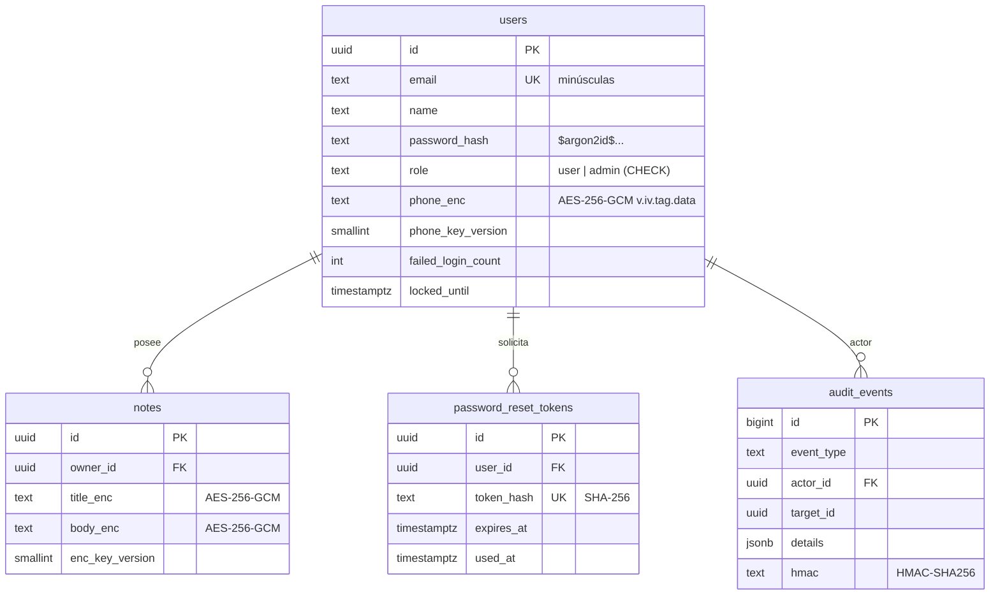
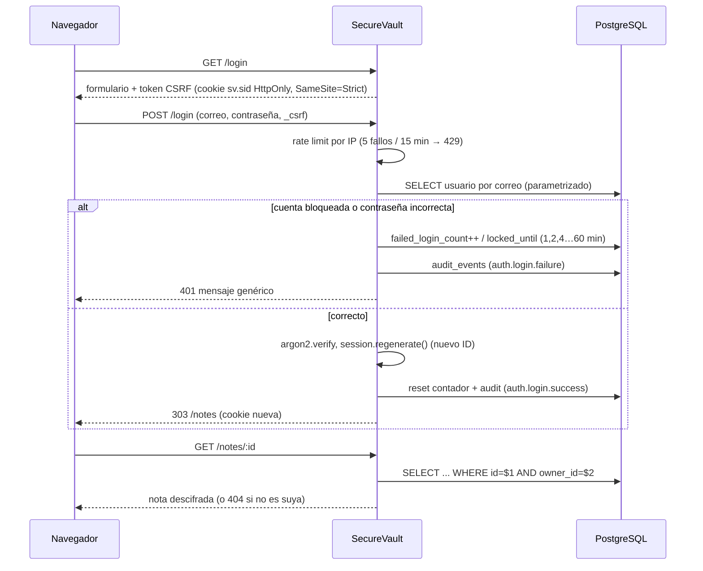

# Fase 1 — Diseño y modelo de amenazas (A06 Insecure Design)

## Modelo de datos



Además: tabla `session` (sesiones del servidor) y `schema_migrations`.

## Flujo de autenticación



## Diagrama de flujo de datos y límites de confianza

```
 [Internet / atacante]
        │  HTTPS (TLS 1.2/1.3)
 ═══════╪═════════════ Límite 1: red pública ══════════════
        ▼
 [Cloudflare + balanceador de Render]  — terminan TLS, filtran ataques (WAF)
        │                                 y entregan la IP real en CF-Connecting-IP
        │
 ═══════╪═════════════ Límite 2: entrada a la aplicación ══
        ▼
 [Contenedor SecureVault, usuario no root]
   helmet/CSP → rate limit → sesión → CSRF/Origin → validación zod → autorización
        │                      │                        │
        │ TLS (verify-full)    │ HTTPS + lista blanca   │ SMTP TLS
 ═══════╪══════════════════════╪════════════════════════╪══ Límite 3: servicios externos
        ▼                      ▼                        ▼
 [Neon PostgreSQL]      [Webhook Slack/Discord]   [Servidor SMTP]
   datos cifrados          alertas                 correo de recuperación

 Secretos: panel de Render → variables de entorno del proceso (nunca en Git ni en la imagen)
```

## STRIDE

| # | Amenaza (STRIDE) | Escenario de abuso | Mitigación | OWASP |
|---|---|---|---|---|
| T1 | **S**poofing | Fuerza bruta / credential stuffing contra `/login` | Rate limit por IP (429), bloqueo progresivo por cuenta, Argon2id lento, alerta a los 5 fallos | A07 |
| T2 | **S**poofing | Fijación de sesión | `session.regenerate()` al autenticar, cookie `HttpOnly`/`Secure`/`SameSite=Strict` | A07 |
| T3 | **S**poofing | Robo del token de recuperación | Token 256 bits, un solo uso, 30 min, solo SHA-256 en BD, `Referrer-Policy: same-origin`, invalidación de sesiones al cambiar contraseña | A04/A07 |
| T4 | **T**ampering | Modificar el texto cifrado en la BD o copiar el cifrado de una nota ajena | AES-GCM (tag 16 B) + AAD ligado a tabla/campo/id | A04/A08 |
| T5 | **T**ampering | CSRF: otro sitio envía formularios con la cookie de la víctima | Token sincronizador + verificación de `Origin` + `SameSite=Strict` | A01 |
| T6 | **T**ampering | Inyección SQL en formularios o en `:id` | Consultas parametrizadas, validación zod, `:id` validado como UUID | A05 |
| T7 | **R**epudiation | Un admin niega haber cambiado un rol; alguien borra rastros en la BD | Bitácora con actor/IP/fecha y HMAC por fila (el panel marca filas alteradas); copia en logs JSON de la plataforma | A09 |
| T8 | **I**nformation disclosure | IDOR: `/notes/<id de otro>` | `WHERE owner_id = usuario actual` en todas las consultas; 404 sin revelar existencia; intento registrado | A01 |
| T9 | **I**nformation disclosure | Robo de copia de la BD | Contraseñas Argon2id, notas y teléfono cifrados, llaves solo en el gestor de secretos | A04 |
| T10 | **I**nformation disclosure | XSS para robar datos de la página | Escape en EJS (`<%= %>`), CSP `script-src 'self'` sin inline | A05 |
| T11 | **I**nformation disclosure | Stack traces o versiones en errores / `/health` | Manejador global con mensaje genérico + `errorId`; `/health` solo `{"status":"ok"}`; sin `X-Powered-By` | A02/A10 |
| T12 | **I**nformation disclosure | Enumeración de usuarios (registro, login, recuperación) | Mismas respuestas exista o no el correo; hash ficticio para igualar tiempos | A07 |
| T13 | **D**enial of service | Crear miles de notas o notas gigantes | Máx. 100 notas/usuario, 5000 caracteres/nota, cuerpo ≤ 64 KB (413), rate limit global | A06 |
| T14 | **D**enial of service | BD lenta bloquea todas las peticiones | `statement_timeout`, `query_timeout`, `connectionTimeoutMillis`, timeouts HTTP del servidor | A10 |
| T15 | **D**enial of service | Bloqueo intencional de la cuenta de otra persona con fallos | Bloqueo temporal y progresivo (máx. 60 min), no permanente; recuperación por correo reinicia el contador | A07 |
| T16 | **E**levation of privilege | Enviar `role=admin` en el formulario de perfil | Esquemas zod estrictos (campos extra descartados); rol solo cambia vía panel admin | A01 |
| T17 | **E**levation of privilege | Usuario normal accede a `/admin` | `requireRole('admin')` con el rol leído de la BD en cada petición; 403 + evento | A01 |
| T18 | **E**levation of privilege | SSRF a través del webhook de alertas (p. ej. a `169.254.169.254`) | Solo HTTPS, host en lista blanca, sin redirecciones, timeout 3 s | A01 |
| T19 | Cadena de suministro | Dependencia comprometida o vulnerable | `package-lock.json`, `npm ci`, `npm audit --audit-level=high` en CI, Dependabot, 11 dependencias directas | A03 |
| T20 | **S**poofing / **D**oS | El reto público (`/reto`) se usa para fuerza bruta masiva o para bloquear la cuenta del reto | Límite propio de 5 intentos/IP/15 min (429), bloqueo progresivo, contraseña aleatoria de 192 bits que no existe en ningún archivo, sin sesión al acertar, sin recuperación de contraseña para esa cuenta, desbloqueo manual por administrador | A07 |

## Límites de negocio

| Límite | Valor | Dónde |
|---|---|---|
| Notas por usuario | 100 | `config.limits.maxNotesPerUser` (comprobado en el INSERT) |
| Título / contenido | 120 / 5000 caracteres | `noteSchema` |
| Tamaño del cuerpo HTTP | 64 KB, 20 campos | `express.urlencoded` |
| Contraseña | 12–128 caracteres, mayúscula, minúscula, número, símbolo | `passwordPolicy` |
| Sesión | 30 min de inactividad, 8 h absoluto | `app.js`, `middleware/auth.js` |
| Token de recuperación | 30 min, un uso, uno vigente por usuario | `services/users.js` |
| Login | 5 fallos/IP/15 min; bloqueo de cuenta desde el 5.º fallo consecutivo | `rateLimit.js`, `services/users.js` |
